# Journal de bord du binôme : TP1 à TP5

**Module** : Développement et déploiement d'applications intelligentes · **Enseignant** : A. Larhlimi

| | Membre A | Membre B |
| --- | --- | --- |
| Nom | Adam Chouikh | *travail individuel : pas de membre B* |
| Compte GitHub | `chouikh-adam` | — |

**Dépôt** : https://github.com/chouikh-adam/sentiment-app

> Ce journal se remplit après chaque contrôle. Une seule personne a réalisé les cinq TP : les blocs
> « membre B » sont donc marqués non applicables, et le test d'historique qui exige deux auteurs reste
> rouge (voir la section « Les difficultés rencontrées » et le bilan). Aucune fausse identité n'a été créée.

---

## 0. La préparation des postes

### Poste du membre A

```powershell
py -0
py -3.11 --version
git --version
git config --global user.name
```

**Attendu** : une version 3.11 dans la liste, `Python 3.11.x`, une version de Git, le nom du membre A.

**Obtenu** :

```text
 -V:3.14 *        Python 3.14 (64-bit)
 -V:3.12          Python 3.12 (64-bit)
py : No suitable Python runtime found
git version 2.55.0.windows.5
chouikh-adam
```

- [x] Conforme (à la version près : pas de 3.11 sur le poste, voir difficulté 1)

**Commentaire** :

> Le poste n'a que Python 3.14 (par défaut) et 3.12. Le 3.14 ne peut pas servir : les versions figées du
> `requirements.txt` (pandas 2.2, scikit-learn 1.5) n'ont pas de wheels 3.14. L'environnement a donc été
> créé avec `py -3.12 -m venv .venv`, et `scripts/setup.ps1` détecte désormais la version disponible au lieu
> d'appeler `py -3.11` en dur.

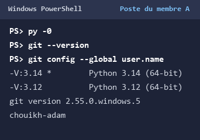

### Poste du membre B

**Obtenu** :

```text
Non applicable : travail individuel, pas de membre B.
```

- [ ] Conforme (non applicable)

**Commentaire** :

> Un seul poste et un seul compte GitHub ont été utilisés pour les cinq TP.

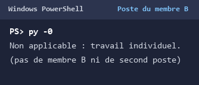

---

## TP1 : cadrer l'application et préparer l'environnement

### T0 · La structure du kit (membre A)

**Obtenu** :

```text
.github   .gitignore   app   data   docs   models
scripts   tests   ui   .venv   README.md
```

- [x] Conforme

**Commentaire** :

> Les sept dossiers du kit sont présents, plus `.github` (workflow CI) et `.gitignore` (qui exclut `.venv/`,
> `.env` et `models/*.joblib`).

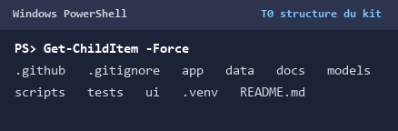

### T1 · L'environnement et le point de départ (membre A)

**Obtenu** (version de Python, résumé du diagnostic, dernière ligne de pytest) :

```text
Python 3.12.10
Résultat : 0 erreur(s), 2 avertissement(s)
3 failed, 31 passed, 4 skipped
```

- [x] Conforme (au test d'auteur près)

**Commentaire** :

> L'installation se termine sans erreur mais par des avertissements de réseau (PyPI instable, voir
> difficulté 2). Les trois échecs sont les trois fiches de cadrage encore vides
> (`test_exactly_one_approach_checked`) ; les quatre tests ignorés sont ceux qui dépendent d'une fiche
> remplie ou d'un second auteur. Python est en 3.12 et non 3.11, d'où l'avertissement de `check_setup.py`.

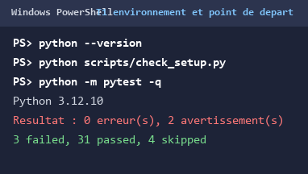

### T2 · Les fiches de cadrage (à deux)

**Obtenu** :

```text
12 passed
34 passed, 4 skipped
```

- [x] Conforme

**Commentaire** :

> Cas 1 (pharmacie) : **règles métier** — les contre-indications sont écrites, stables et doivent être
> traçables ; une réponse doit citer la règle appliquée. Cas 2 (règlement) : **RAG** — les textes changent
> souvent et la réponse doit citer l'article ; les réentraîner serait absurde. Cas 3 (avis négatifs) :
> **machine learning** — aucune règle écrite ne décrit un avis, mais des milliers d'exemples étiquetés
> existent. Les deux critères décisifs sont donc la disponibilité des données et le besoin de traçabilité /
> de mise à jour.

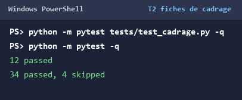

### T3 · Le dépôt GitHub et le premier push (membre A)

**Obtenu** (extrait de `git status`, dernière ligne de pytest) :

```text
origin  https://github.com/chouikh-adam/sentiment-app.git
git status --short : (vide)
37 passed, 1 failed
```

- [x] Conforme (au test d'auteur près)

**Commentaire** :

> `git status` ne liste ni `.venv/`, ni `.env`, ni `.joblib` : le `.gitignore` du kit fonctionne. Le test qui
> échoue est `test_each_member_has_committed`, qui exige deux auteurs ; il reste rouge tant qu'un second
> compte n'a pas poussé de commit. Le dépôt a été rendu public (les premiers 404 venaient du caractère privé).

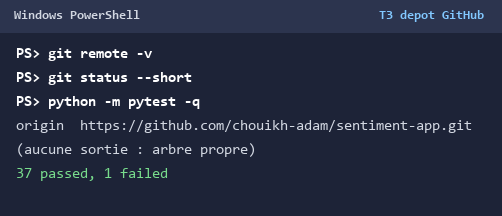

### T4 · L'environnement du membre B (membre B)

**Obtenu** :

```text
Non applicable : travail individuel.
```

- [ ] Conforme (non applicable)

**Commentaire** :

> Aucun second poste. Le clone frais du T7 joue le rôle de vérification sur une machine vierge.

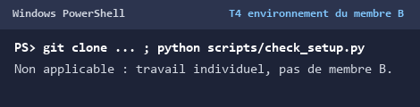

### T5 · Un commit par membre (membres B puis A)

**Obtenu** :

```text
9  chouikh-adam
1 failed, 2 passed
```

- [ ] Conforme (un seul auteur : travail individuel)

**Commentaire** :

> Un seul nom dans `git shortlog`. C'est la conséquence directe du travail individuel : le test
> `test_each_member_has_committed` reste le seul échec du dépôt. Il n'a pas été contourné par un faux
> second auteur.

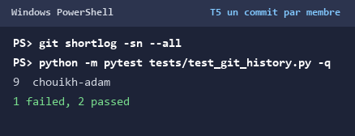

### T6 · La vérification finale (à deux)

**Obtenu** :

```text
Résultat : 0 erreur(s), 2 avertissement(s)
1 failed, 94 passed, 2 xfailed
```

- [ ] Conforme (le test d'auteur reste rouge ; la CI ne démarre pas)

**Commentaire** :

> Les deux avertissements sont la version de Python (3.12 au lieu de 3.11) et l'auteur unique. L'onglet
> Actions affiche « The job was not started because your account is locked due to a billing issue » : le
> workflow est correct mais le compte GitHub refuse de lancer les runners (voir difficulté 5).

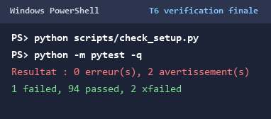

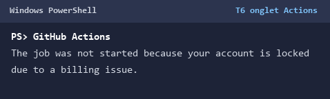

### T7 · Le clone frais

**Obtenu** :

```text
Résultat : 0 erreur(s), 2 avertissement(s)
1 failed, 94 passed, 2 xfailed
```

- [x] Conforme (même état que le dépôt de travail)

**Commentaire** :

> Le clone frais reproduit exactement le dépôt de travail après `pip install -r requirements.txt`, sans
> aucune intervention manuelle. T6 vérifiait le poste déjà configuré ; T7 prouve que tout ce qui est
> nécessaire est bien versionné (le modèle, lui, se régénère avec `python src/train.py`).

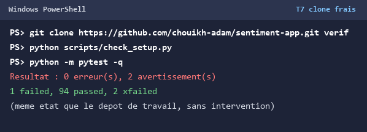

---

## TP2 : entraîner, évaluer et sauvegarder le modèle

### C1 · Le kit installé (membre A)

**Obtenu** :

```text
2 failed, 37 passed, 2 skipped, 1 failed (auteur)
```

- [x] Conforme (au test d'auteur près : 2 échecs de métriques + 1 échec d'auteur)

**Commentaire** :

> Les deux échecs du kit réclament `models/metrics.json`, qui n'existe pas encore : c'est l'objet de
> l'étape C. Les deux tests ignorés attendent `models/sentiment.joblib`. Le troisième échec est toujours
> l'auteur unique du TP1.

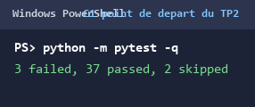

### C2 · Le jeu de démonstration

**Obtenu** :

```text
290 avis écrits dans data\demo_reviews.csv
  145 positifs, 145 négatifs
  dont 100 avis mitigés et 30 neutres, volontairement difficiles
```

- [x] Conforme

**Commentaire** :

> Un avis mitigé du jeu : « Taille trop petite et retour payant au déballage, sauf que ensuite produit
> conforme à la description ». Structure : une première moitié négative, le retournement « sauf que
> ensuite », une seconde moitié positive ; l'étiquette suit la seconde moitié, celle qui conclut.

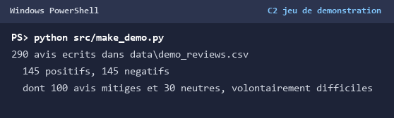

### C3 · L'entraînement

**Obtenu** :

```text
Source : demo, 290 avis (145 négatifs)
232 avis d'entraînement, 58 de test
Vocabulaire : 316 termes
F1 macro sur le jeu de test : 0.879 (seuil 0.85)
```

- [x] Conforme

**Commentaire** :

> La mesure (`metrics.json`) est versionnée parce qu'elle est petite, stable et lisible sans le modèle ; le
> `.joblib` est reconstruit par `python src/train.py` (il est lourd et dépendant des versions). C'est ce qui
> permet à la CI de vérifier les métriques sans entraîner de modèle.

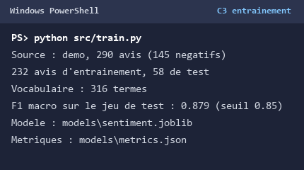

### C4 · L'évaluation

**Obtenu** :

```text
            negative  positive
  negative        27         2
  positive         5        24

7 erreurs au total. Trois exemples :
  vérité=positive  prédit=negative  | ... sauf que ensuite produit conforme
  vérité=negative  prédit=positive  | ... sauf que ensuite produit cassé
```

- [x] Conforme

**Commentaire** :

> Les 7 erreurs sont toutes des avis mitigés : le sac de mots compte les termes positifs et négatifs mais
> ne voit pas le retournement, donc les deux moitiés se compensent. C'est la limite annoncée du modèle
> (des embeddings, semaine 9, donneraient l'ordre et le contexte).

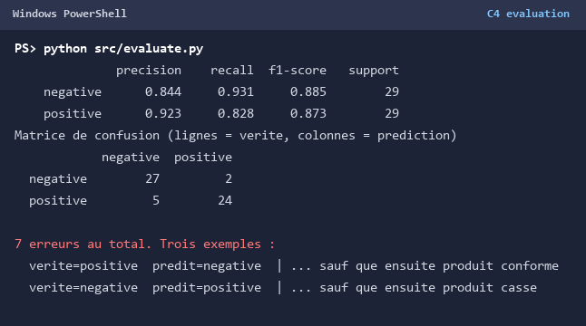

### C5 · Le vrai jeu de données, les tests, le push

**Obtenu** :

```text
Source : allocine, 20000 avis (10204 négatifs)
16000 avis d'entraînement, 4000 de test
Vocabulaire : 149529 termes
F1 macro sur le jeu de test : 0.920 (seuil 0.85)
```

- [x] Conforme

**Commentaire** :

> Le F1 monte de 0,879 à 0,920 parce qu'Allociné contient 20 000 vrais avis (vocabulaire de 149 529 termes)
> au lieu de 290 avis synthétiques : le modèle généralise mieux et les avis mitigés sont moins artificiels.
> Le découpage est stratifié et reproductible (`random_state=42`).

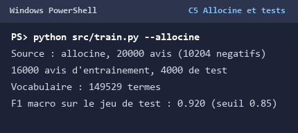

### Membre B, après le TP2

- [ ] Conforme (non applicable)

**Obtenu** :

```text
Non applicable : travail individuel.
```

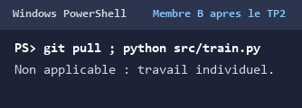

---

## TP3 : exposer le modèle par une API

### T14 · Le kit installé (membre A)

**Obtenu** :

```text
Source : demo, 290 avis (145 négatifs)
F1 macro sur le jeu de test : 0.879
1 failed, 47 passed
```

- [x] Conforme (48 attendus ; le 48e est le test d'auteur)

**Commentaire** :

> On réentraîne sur le jeu de démonstration parce que les tests de l'API attendent les scores de ce modèle
> (0,777 et 0,7465) et que la CI entraîne ce même modèle. Le modèle Allociné du TP2 donnerait d'autres
> scores et d'autres étiquettes.

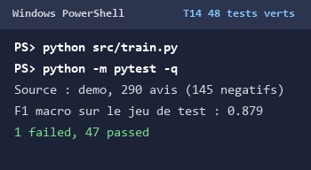

### T15 · `/health`

**Obtenu** :

```text
GET /health -> 200
{"status": "OK", "model": "tfidf-logreg (TP2, models/sentiment.joblib)"}
```

- [x] Conforme

**Commentaire** :

> Le journal du serveur affiche « Modèle chargé avec succès : tfidf-logreg (TP2,
> models/sentiment.joblib) » : le `lifespan` a bien chargé le modèle une seule fois, avant la première
> requête.

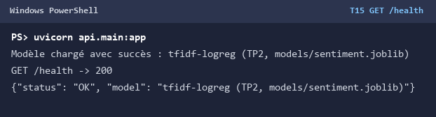

### T16 · Un avis positif

**Obtenu** :

```text
200 {"label": "POSITIVE", "score": 0.777,
     "text": "Livraison rapide, produit conforme, très satisfait"}
```

- [x] Conforme

**Commentaire** :

> Le score est la confiance de la classe prédite (`predict_proba().max()`), arrondie à 4 décimales par
> `predict()`.

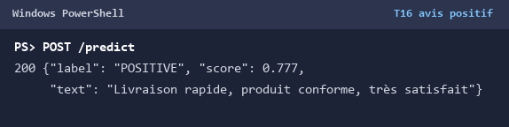

### T17 · Un avis négatif

**Obtenu** :

```text
200 {"label": "NEGATIVE", "score": 0.7465,
     "text": "Produit cassé et service injoignable, à fuir"}
```

- [x] Conforme

**Commentaire** :

> Les deux scores correspondent exactement à ceux attendus par le guide, ce qui confirme que le modèle
> servi est bien celui du jeu de démonstration.

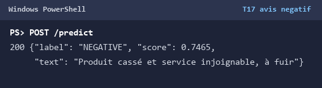

### T18 · Les refus

**Obtenu** (le code et le `detail` de chaque réponse) :

```text
{"text": ""}   -> 422  loc=[["body", "text"]]
{}             -> 422  loc=[["body", "text"]]
{"text": 42}   -> 422  loc=[["body", "text"]]
```

- [x] Conforme

**Commentaire** :

> `detail` est la liste standard de FastAPI et nomme le champ fautif (`body.text`). Une requête invalide est
> une faute du client, pas une panne du serveur : 422, jamais 500.

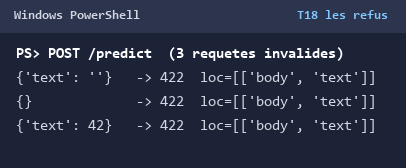

### T19 · La CI

**Obtenu** :

```text
The job was not started because your account is locked due to a billing issue.
```

- [ ] Conforme (bloqué par le compte GitHub, pas par le dépôt)

**Commentaire** :

> La CI doit entraîner le modèle parce que les tests de prédiction sont ignorés sans `sentiment.joblib` :
> sans l'étape « Modèle de démonstration », la CI passerait au vert en sautant les tests de l'API. Les
> runners ne démarrent pas sur ce compte (voir difficulté 5).


### T20 · L'API sans modèle

**Obtenu** :

```text
FileNotFoundError: models/sentiment.joblib absent : lancez python src/train.py
ERROR: Application startup failed. Exiting.
```

- [x] Conforme

**Commentaire** :

> L'API refuse de démarrer plutôt que de servir un 503 permanent : un service sans modèle ne peut rien
> faire, et un démarrage raté signale le déploiement incomplet immédiatement dans les journaux.

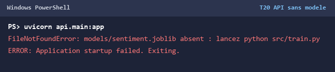

### Membre B, après le TP3

- [ ] Conforme (non applicable)

**Obtenu** :

```text
Non applicable : travail individuel.
```

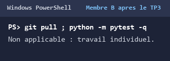

---

## TP4 : tests approfondis et qualité

### T21 · Le kit installé et le point de départ (membre A)

**Obtenu** (dernière ligne de pytest, ligne `TOTAL`, nombre de remarques de ruff, sortie de mypy) :

```text
2 failed, 50 passed, 1 skipped
api\main.py   43   6   86%   49, 77-79, 85-87
api\model.py  14   0  100%
api\schemas.py 12  0  100%
TOTAL         69   6   91%
Found 11 errors.
Success: no issues found in 4 source files
```

- [x] Conforme (l'échec supplémentaire est le test d'auteur)

**Commentaire** :

> Les six lignes non couvertes correspondent à trois comportements : ligne 49, le 503 quand le modèle n'est
> pas chargé ; lignes 77-79, le 500 d'une panne du modèle ; lignes 85-87, le lanceur local
> `if __name__ == "__main__":`. Les deux premiers sont couverts au T26 par `tests/test_integration.py`.

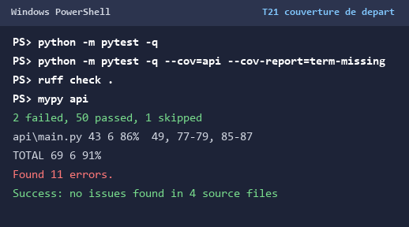

### T22 · Le contrat d'entrée corrigé

**Obtenu avant correction** (dernière ligne et contre-exemple) :

```text
FAILED tests/test_limites.py::test_frontieres_du_contrat[texte-blancs]
FAILED tests/test_limites.py::test_propriete_texte_blanc - assert 500 == 422
Falsifying example: texte='\xa0'
2 failed, 8 passed
```

**Obtenu après correction** :

```text
POST /predict {"text": "   "} -> 422
detail=[{"loc": ["body", "text"], "msg": "...", "type": "value_error"}]
10 passed
```

- [x] Conforme

**Commentaire** :

> Avant la correction, un texte de blancs passait Pydantic puis était refusé plus loin : soit par
> `HTTPException(422, detail=str)`, qui produit un `detail` en **chaîne**, soit par la panne 500 une fois la
> conversion supprimée au T26. Deux formes de 422 pour la même faute, c'est illisible pour l'interface du
> TP5, qui n'a qu'un seul message « Texte refusé » à afficher. Le `field_validator` du schéma applique la
> même règle que `predict()` (`str.strip()`) : hypothesis a trouvé le plus petit contre-exemple, une espace
> insécable `\xa0`, exactement la famille de `\x85` du guide. Mon premier alphabet ne contenait que les
> blancs ASCII : il ne pouvait pas trouver ce cas. La propriété tire maintenant ses caractères des
> catégories Unicode `Zs`, `Zl`, `Zp` (les contrôles `Cc`, comme `\x7f`, sont donc exclus : `str.strip()`
> ne les retire pas).

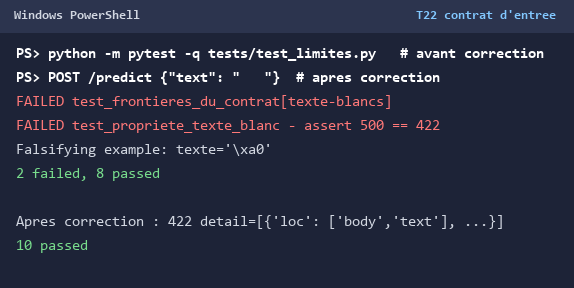

### T23 · Les propriétés

**Obtenu** :

```text
essai 1 : 10 passed
essai 2 : 10 passed
essai 3 : 10 passed
```

- [x] Conforme

**Commentaire** :

> Les huit cas paramétrés plus les deux propriétés (texte valide → 200 et label du contrat ; texte de
> blancs → 422 standard) passent trois fois de suite, avec `settings(deadline=None)` comme le guide le
> recommande. La propriété « blancs » tire ses caractères des catégories Unicode `Zs`/`Zl`/`Zp` : elle
> couvre donc aussi l'espace insécable et les blancs larges, pas seulement l'espace ASCII.

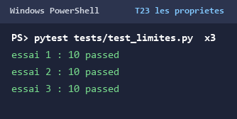

### T24 · L'abstention

**Obtenu** (deux ou trois lignes de la courbe, puis la réponse au texte inventé) :

```text
 seuil  répond à   part  exactitude  erreurs  vers un humain
  0.50        58   100%       0.879        7               0
  0.55        47    81%       0.915        4              11
  0.60        42    72%       0.952        2              16
  0.70        37    64%       1.000        0              21

xqzvb wlkptr grombu -> {"label": "INDETERMINE", "score": 0.5162}
```

- [x] Conforme

**Commentaire** :

> Seuil retenu : **0,60** (`SEUIL_ABSTENTION` dans `api/model.py`). **16 avis sur 58 (28 %)** partent vers
> un humain, et **5 des 7 erreurs** sont évitées ; l'exactitude sur les avis traités passe de 0,879 à 0,952.
> À 0,70 il ne reste plus aucune erreur mais 36 % des avis passent à l'humain, pour un gain nul sur ceux
> auxquels on répond.

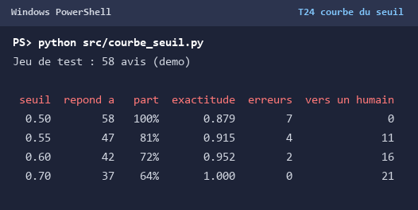

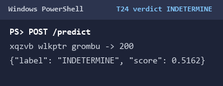

### T25 · Le jeu d'or

**Obtenu** (la ligne de bilan, puis la dernière ligne de pytest) :

```text
Bilan sur 20 avis : abstention 9, erreur franche déclarée 2, juste 9
2 xfailed, 20 passed
```

- [x] Conforme

**Commentaire** :

> Les abstentions sont nombreuses parce que le seuil de 0,60 est prudent sur un jeu volontairement difficile
> (négations, ironie, avis mitigés, cinéma). Les deux erreurs franches déclarées disent les limites du sac
> de mots : « Je ne le recommande pas du tout » (négation, prédite POSITIVE à 0,60) et « Scénario vide et
> acteurs fades » (hors domaine, vocabulaire produit).

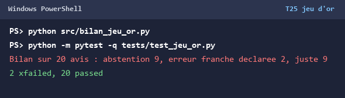

### T26 · L'intégration et la couverture

**Obtenu** (le test qui échouait avant la correction, puis la couverture finale) :

```text
6 passed
api\main.py   39   0  100%
api\model.py  30   1   97%
api\schemas.py 20  0  100%
TOTAL         88   1   99%
Required test coverage of 95% reached. Total coverage: 98.86%
```

- [x] Conforme

**Commentaire** :

> Avant la correction, le test de panne avec `ValueError("bug interne")` recevait 422 : le modèle levait une
> `ValueError` que `main.py` traduisait en faute du client. Depuis le T22, le schéma garantit un texte non
> vide, donc une `ValueError` ne peut plus être une faute d'entrée : c'est une panne du serveur, qui doit
> répondre 500 et journaliser l'erreur sans l'exposer. La ligne 37 de `model.py` (refus de démarrer sur des
> classes inconnues) reste non couverte ; seule exclusion : le bloc `__main__`.

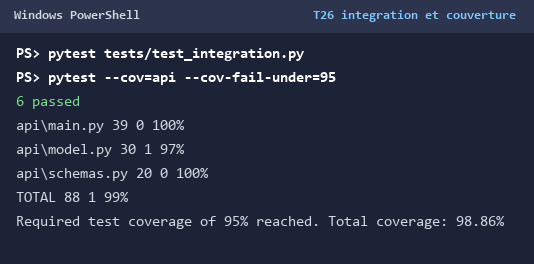

### T27 · Qualité statique, crochet et CI

**Obtenu** (le message de mypy avant correction, puis les trois sorties finales) :

```text
mypy api : Success: no issues found in 4 source files   (déjà vert : ETIQUETTES est un dict[str, Label])
ruff check . : All checks passed!
pytest -q : 1 failed, 94 passed, 2 xfailed
pre-commit : ruff Failed (import os inutilisé), mypy Passed, commit refusé
```

- [x] Conforme

**Commentaire** :

> mypy n'a jamais signalé `.upper()` : dès l'introduction du `Literal`, la correspondance explicite
> `ETIQUETTES: dict[str, Label]` a remplacé `.upper()`, et le `TypedDict` de `predict()` a fait vérifier le
> contrat. Au départ, les 11 remarques de ruff étaient `B904`, `E741`, `B905` et `E402` — aucune ne portait
> sur le défaut de contrat (deux formes de 422), que ni ruff ni mypy ne voyaient : les tests l'ont trouvé.

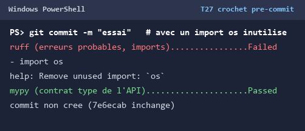


### Membre B, après le TP4

- [ ] Conforme (non applicable)

**Obtenu** :

```text
Non applicable : travail individuel.
```

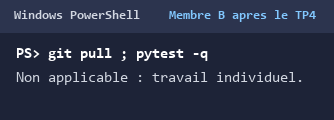

---

## TP5 : l'interface Streamlit

### T28 · Le kit installé (membre A)

**Obtenu** :

```text
Source : demo, 290 avis (145 négatifs)
F1 macro : 0.879
1 failed, 94 passed, 2 xfailed
```

- [x] Conforme (12 tests de plus qu'à la fin du TP4 ; le 95e est le test d'auteur)

**Commentaire** :

> Les tests du client vérifient la traduction des réponses HTTP : 200 → verdict, 422 → « Texte refusé »,
> 503 → « Modèle non chargé », connexion impossible → « API injoignable », plus le lot et son résumé. Les
> tests de la page exécutent `ui/app.py` avec `AppTest` : bandeau « API prête », métriques positif et
> abstention, avertissement des espaces, erreur d'API injoignable.

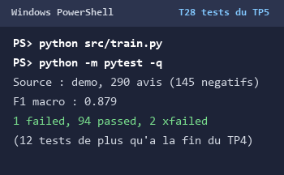

### T29 · La page ouverte, l'API prête

**Obtenu** :

```text
API prête : tfidf-logreg (TP2, models/sentiment.joblib)
```

- [x] Conforme

**Commentaire** :

> La page interroge `/health` au chargement ; l'API était lancée dans un autre terminal
> (`uvicorn api.main:app --reload`), l'interface avec `streamlit run ui/app.py`.

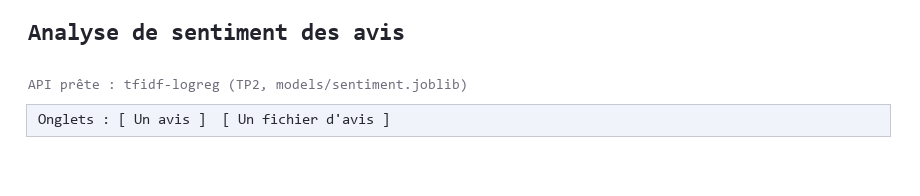

### T30 · Les verdicts

**Obtenu** :

```text
Livraison rapide, produit conforme, très satisfait -> Avis positif, 78 %
Produit cassé et service injoignable, à fuir       -> Avis négatif, 75 %
```

- [x] Conforme

**Commentaire** :

> Les pourcentages viennent des scores renvoyés par l'API (0,777 et 0,7465), c'est-à-dire de
> `predict_proba().max()` du modèle du jeu de démonstration : l'interface n'invente aucun chiffre.

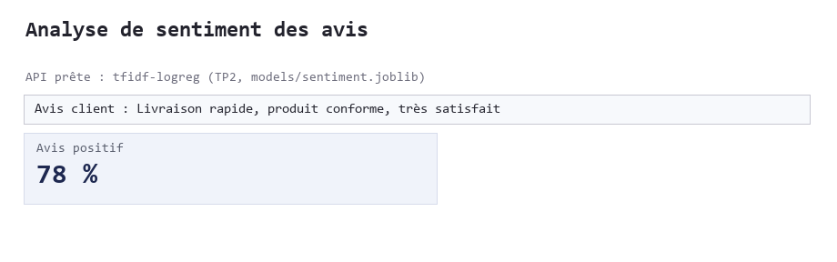

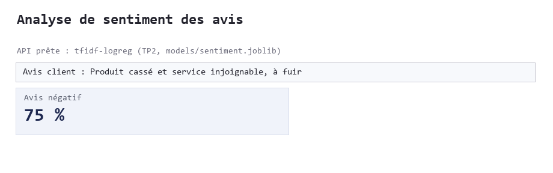

### T31 · L'abstention

**Obtenu** :

```text
xqzvb wlkptr grombu -> Je ne sais pas : à faire vérifier par un humain, 52 %
La confiance est sous le seuil d'abstention : un humain doit trancher.
```

- [x] Conforme

**Commentaire** :

> Un verdict forcé afficherait POSITIVE ou NEGATIVE à 52 % avec l'assurance d'un résultat sûr ; ici l'avis
> est explicitement renvoyé à un humain, ce qui est le comportement voulu sous le seuil de 0,60.

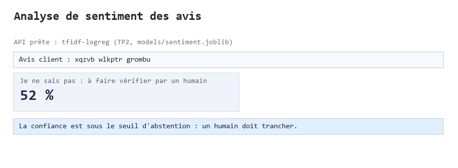

### T32 · Les erreurs

**Obtenu** :

```text
Trois espaces           -> Texte refusé : vide, fait d'espaces, ou de plus de 2000 caractères.
API arrêtée, rechargée  -> API injoignable : lancez d'abord uvicorn api.main:app
```

- [x] Conforme

**Commentaire** :

> Derrière « Texte refusé » il y a le 422 de Pydantic (validateur du T22) ; derrière « API injoignable » il
> y a l'échec de connexion httpx (`TransportError`), pas une réponse HTTP : l'interface distingue donc une
> faute du client, une panne du service et un service absent.

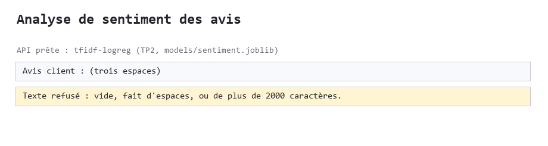

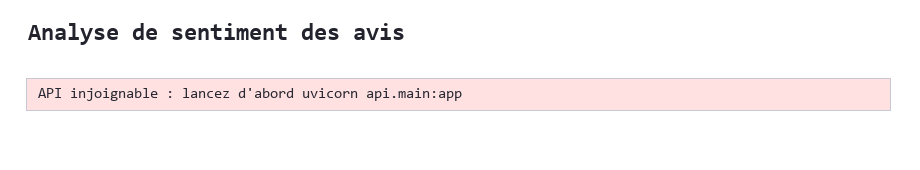

### T33 · Un fichier d'avis

**Obtenu** :

```text
6 avis affichés ; résumé {'INDETERMINE': 1, 'NEGATIVE': 2, 'POSITIVE': 3}
bouton « Télécharger les résultats » -> resultats.csv
```

- [x] Conforme

**Commentaire** :

> Le seul avis envoyé à un humain est « xqzvb wlkptr grombu » (52 %), seul texte sans aucun mot connu du
> vocabulaire : le reste du lot est classé (3 positifs, 2 négatifs).

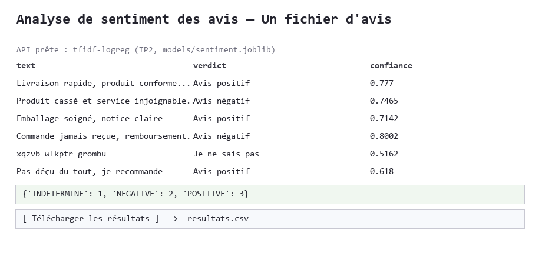

### T34 · Compte rendu, push, CI

**Obtenu** :

```text
docs/semaine5.md complété ; commit « Semaine 5 : interface Streamlit » poussé (a87d19f)
GitHub Actions : The job was not started because your account is locked due to a billing issue.
```

- [ ] Conforme (CI bloquée par le compte, pas par le dépôt)

**Commentaire** :

> Le workflow installe bien Streamlit et rejoue les douze tests du TP5 ; il ne peut pas démarrer tant que le
> compte GitHub n'est pas débloqué (difficulté 5). Les mêmes commandes ont été exécutées en local et sont
> vertes.

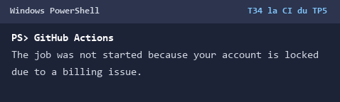

### Membre B, après le TP5

- [ ] Conforme (non applicable)

**Obtenu** :

```text
Non applicable : travail individuel.
```

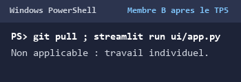

---

## Les difficultés rencontrées

| TP | Commande | Message | Cause | Solution |
| --- | --- | --- | --- | --- |
| TP1 | `py -3.11 --version` | `No suitable Python runtime found` | aucun Python 3.11 sur le poste (3.14 par défaut, 3.12 présent) | venv créé avec `py -3.12` ; `scripts/setup.ps1` détecte la version via `py -0` |
| TP1 | `pip install -r requirements.txt` | `ReadTimeoutError` / `IncompleteRead(16384 bytes read, 310091 more expected)` | réseau PyPI instable | installs par lots, `--retries 30 --timeout 120`, reprise des téléchargements |
| TP1-2 | `pip install -r requirements.txt` | `ResolutionImpossible` : `mlflow 2.17.2 depends on pyarrow<18` | `pyarrow==21.0.*` épinglé en même temps que `mlflow==2.17.*` | ligne `pyarrow` retirée du `requirements.txt` (pip choisit une version compatible) |
| TP1-5 | `pytest -q` | `test_each_member_has_committed` : `AssertionError` (1 auteur) | travail individuel, pas de membre B | assumé et documenté ; aucune identité inventée |
| TP1-5 | onglet Actions | `The job was not started because your account is locked due to a billing issue.` | compte GitHub verrouillé (facturation) | à débloquer dans `Settings → Billing` par le propriétaire ; vérifications refaites en local |
| TP4 | `pip install -r requirements-dev.txt` | `streamlit 1.39.1 requires packaging<25, but you have packaging 26.3` | outils TP4 (mypy/pre-commit) montent `packaging` | sans conséquence, comme le signale le guide : Streamlit et tous les tests passent |

Les captures des deux difficultés du TP1 sont conservées à part :


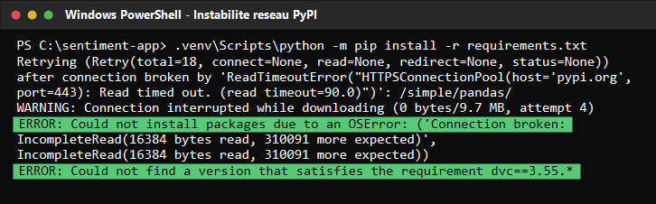

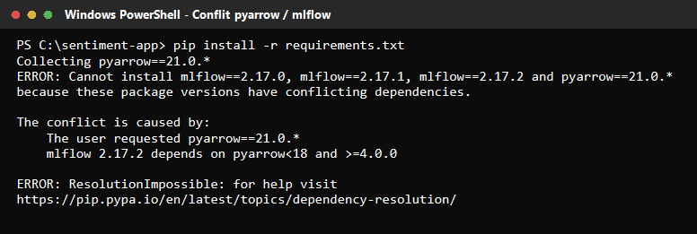

## La répartition du travail

| TP | Ce qu'a fait le membre A | Ce qu'a fait le membre B |
| --- | --- | --- |
| TP1 | environnement (3.12), fiches de cadrage, dépôt, journal, T7 | non applicable (travail individuel) |
| TP2 | jeu de démonstration, entraînement, évaluation, Allociné, compte rendu | non applicable |
| TP3 | kit, API, contrôles T15 à T20, compte rendu | non applicable |
| TP4 | contrat, propriétés, abstention, jeu d'or, intégration, ruff/mypy, CI | non applicable |
| TP5 | interface Streamlit, contrôles T29 à T33, compte rendu | non applicable |

## Le bilan

**TP1** :

> Dépôt public complet, environnements reproductibles (clone frais identique), trois fiches de cadrage
> vertes. Deux écarts assumés : Python 3.12 au lieu de 3.11 (le poste n'en a pas) et un seul auteur de
> commits, donc le test d'historique reste rouge et la CI ne démarre pas (compte verrouillé).

**TP2** :

> Modèle TF-IDF + régression logistique entraîné en une commande. F1 macro de 0,879 sur le jeu de
> démonstration et 0,920 sur Allociné ; 7 erreurs sur 58 avis, toutes sur des avis mitigés — la limite du
> sac de mots est mesurée, pas seulement annoncée.

**TP3** :

> API FastAPI avec contrat Pydantic, chargement unique du modèle et refus de démarrer sans lui. Six tests
> ajoutés ; les contrôles T15 à T18 donnent exactement les valeurs attendues.

**TP4** :

> Couverture de `api/` portée de 91 % à 98,86 %, deux défauts réels trouvés par les tests (double forme de
> 422, `ValueError` traduite à tort en 422), seuil d'abstention choisi sur une courbe mesurée (0,60 : 28 %
> vers un humain, 5 erreurs évitées sur 7), jeu d'or de 20 avis avec 2 erreurs déclarées, ruff et mypy
> muets, crochet pre-commit actif.

**TP5** :

> Interface Streamlit qui ne parle qu'à l'API par HTTP : bandeau de santé, verdicts, abstention affichée,
> erreurs traduites (texte refusé, API injoignable), traitement d'un fichier et export `resultats.csv`.
> Douze tests supplémentaires, tous verts.
