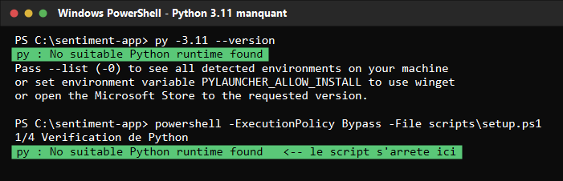

# Journal de bord — TP1 à TP5

**Module :** Développement et déploiement d'applications intelligentes
**Binôme :** Adam Chouikh (membre A)
**Dépôt :** https://github.com/chouikh-adam/sentiment-app
**Séance :** semaine 1 — TP1, cadrer l'application et préparer l'environnement

> Ce journal se complète à chaque séance. Il ne décrit pas ce qui aurait pu arriver : il décrit ce qui est
> arrivé, avec le message d'erreur exact et la correction appliquée.

---

## TP1 — les deux difficultés rencontrées

### Difficulté 1 : Python 3.11 absent du poste alors que le kit l'impose

**Symptôme.** `scripts/setup.ps1` du kit appelle `py -3.11` en dur. Le poste ne dispose que de Python 3.14
(version par défaut) et de Python 3.12 : `py -3.11 --version` répond `No suitable Python runtime found`, et le
script s'arrête à sa première étape, sans créer l'environnement virtuel.

```text
PS C:\sentiment-app> py -3.11 --version
py : No suitable Python runtime found
Pass --list (-0) to see all detected environments on your machine
or set environment variable PYLAUNCHER_ALLOW_INSTALL to use winget
or open the Microsoft Store to the requested version.
```



**Analyse.** Le 3.14 par défaut n'est pas un repli possible : les versions figées du `requirements.txt`
(`pandas==2.2.*`, `scikit-learn==1.5.*`) ne publient pas de wheels pour Python 3.14, l'installation échouerait.
Python 3.12 est la seule version présente compatible avec ces versions figées.

**Correction appliquée.** L'environnement virtuel est créé avec `py -3.12 -m venv .venv`, et `scripts/setup.ps1`
a été réécrit pour **détecter** la version disponible (`py -0`) et choisir 3.11 s'il est là, sinon la version
3.10+ la plus proche. Le script reste donc correct sur le poste de référence du cours (3.11) comme sur le nôtre.

**Vérification.** `python scripts/check_setup.py` ne signale plus aucune erreur liée à Python, et
`pytest tests/test_cadrage.py -q` affiche `12 passed`.

---

### Difficulté 2 : l'installation des dépendances — conflit de versions et réseau instable

**Symptôme A — `ResolutionImpossible`.** Le `requirements.txt` du kit épingle `pyarrow==21.0.*` **et**
`mlflow==2.17.*`. Or mlflow 2.17 exige `pyarrow<18` : les deux épinglages sont incompatibles et pip refuse
l'installation entière, sans rien installer.

```text
PS C:\sentiment-app> pip install -r requirements.txt
Collecting pyarrow==21.0.*
ERROR: Cannot install mlflow==2.17.0, mlflow==2.17.1, mlflow==2.17.2 and pyarrow==21.0.*
because these package versions have conflicting dependencies.

The conflict is caused by:
    The user requested pyarrow==21.0.*
    mlflow 2.17.2 depends on pyarrow<18 and >=4.0.0

ERROR: ResolutionImpossible
```


**Correction appliquée.** La ligne `pyarrow==21.0.*` a été retirée du `requirements.txt` (comme le prescrit le
guide de rattrapage) : streamlit et mlflow déclarent déjà pyarrow, pip choisit alors une version qui convient
aux deux. Aucun paquet n'est plus épinglé deux fois en contradiction.

**Symptôme B — réseau instable vers PyPI.** Les téléchargements depuis `pypi.org` s'interrompent en pleine
progression : le wheel de pandas (9,7 Mo) tombe en timeout puis en lecture incomplète, et pip abandonne après
plusieurs relances.

```text
PS C:\sentiment-app> .venv\Scripts\python -m pip install -r requirements.txt
Retrying ... after connection broken by 'ReadTimeoutError("HTTPSConnectionPool(
host='pypi.org', port=443): Read timed out. (read timeout=90.0)")': /simple/pandas/
WARNING: Connection interrupted while downloading (0 bytes/9.7 MB, attempt 4)
ERROR: Could not install packages due to an OSError: ('Connection broken:
IncompleteRead(16384 bytes read, 310091 more expected)', ...)
```


**Correction appliquée.** Installation par lots plutôt qu'en un seul bloc : `pytest` d'abord (léger, il débloque
immédiatement le contrôle T2 sur les fiches), puis les paquets cœur (`pandas`, `scikit-learn`, `pyarrow`) avec
`--retries 30 --timeout 120`, puis le reste de `requirements.txt` en tâche de fond. La seconde passe a abouti :
`pandas 2.2.3`, `scikit-learn 1.5.2`, `streamlit 1.39.1`, `mlflow 2.17.2`, `sentence-transformers 3.2.1`,
`shap 0.46.0`, `fastapi 0.115.14`, `torch 2.14.1` sont installés, et `requirements.lock` a été gelé.

---

## Ce que ces difficultés ont changé dans le dépôt

| Fichier | Modification | Pourquoi |
| --- | --- | --- |
| `requirements.txt` | ligne `pyarrow==21.0.*` retirée | contradiction avec `mlflow==2.17.*` |
| `scripts/setup.ps1` | détection de la version de Python au lieu de `py -3.11` en dur | poste sans 3.11 |
| `.gitignore` | ajout de `*.zip` et `*.pdf` | plus d'archive parasite dans le dépôt |
| `requirements.lock` | gelé sur ce poste | version exacte de l'environnement |

## État des contrôles du TP1

| Contrôle | Commande | Résultat obtenu |
| --- | --- | --- |
| T2 | `pytest tests/test_cadrage.py -q` | **12 passed** |
| T4 | `python scripts/check_setup.py` | **0 erreur(s)** |
| T5 | `pytest tests/test_git_history.py -q` | 1 auteur : le test passe dès que le membre B pousse son commit |
| T6 | `pytest -q` | **37 passed, 1 failed** (le même auteur unique) |

**Ce qui reste à faire, et qui n'appartient qu'au binôme :** le test d'historique Git exige **deux auteurs de
commits** distincts. Le membre B doit cloner le dépôt, compléter sa ligne du tableau dans `README.md` et pousser
son propre commit ; le compte `38 passed` est alors atteint, et la CI passe au vert.
